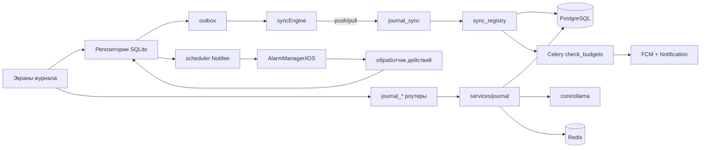

# Requirements

### Overview & Goals
Новый раздел «Журнал» — личный журнал жизни с календарём в центре: диета, финансы (рубли, копейки в `BigInteger`), дневник, пользовательские трекеры (вес — частный случай), цели, аналитика и экспорт, точные напоминания. Работает офлайн (SQLite + синхронизация). **Тренировок нет** — ни таблиц, ни типов событий под них.

Этот документ — результат **Фазы 0** (проектирование). Код пишется только после вашего подтверждения, по фазам 1–5, с остановкой после каждой.

### Уточнения допущений по итогам изучения проекта
| В задании | В проекте | Как поступаем |
|---|---|---|
| `app/config.py` | `app/core/config.py` | настройки журнала — отдельным блоком там |
| текущий пользователь в `app/api/dependencies.py` | `get_current_user` в `app/core/auth.py`; в `dependencies.py` только `get_async_db` | используем `app/core/auth.get_current_user` + `get_async_db` |
| регистрация роутеров в `app/main.py` | список в `app/api/routers/__init__.py` | добавляем `journal_*` туда |
| «существующий клиент Ollama» | только приватная `_call_ollama` в `app/api/routers/ai.py` | выносим её в `app/core/ollama.py`, `ai.py` переводим на него без изменения поведения |
| файловое хранилище | `app/utils/storage.save_file()`, но `/media/{path}` в `main.py` отдаёт файлы **без авторизации** | вложения журнала — в категории `journal/u<id>/…`, отдача только владельцу через `/api/journal/attachments/{uuid}/file`; путь `/media/journal/…` закрыт (404) |
| Celery beat | в `docker-compose*.yml` только `celery_worker` | добавляем сервис `celery_beat` и `beat_schedule` |
| часовой пояс пользователя | в `User` поля нет | храним в `journal_settings.timezone`, `users` не трогаем |
| конфиг-плагин Notifee | `withNotificationAndroidPlugin.js` объявляет несуществующие классы `io.invertase.notifee.NotifeeEventReceiver` (с BOOT_COMPLETED, при загрузке телефона даёт ClassNotFoundException), `app.notifee.core.RebootService`, а `ReceiverService` объявлен как receiver | убираем лишнее: AAR ядра Notifee сам объявляет `RebootBroadcastReceiver`, `NotificationAlarmReceiver`, `AlarmPermissionBroadcastReceiver`, `SCHEDULE_EXACT_ALARM`, `RECEIVE_BOOT_COMPLETED` |
| XLSX «позже» | `openpyxl` уже в `requirements.txt` | XLSX поддерживаем сразу (read_only) |
| `pytest` | в `requirements.txt` нет | добавляем `pytest`, `pytest-asyncio` |

### Scope
**In Scope:** фазы 1–4 полностью, фаза 5 (Health) — опционально, после отдельного подтверждения.

**Out of Scope:** тренировки, импорт SMS, шаринг данных, PIN и биометрия, веб-версия, валюты кроме RUB (операции в другой валюте только помечаются).

### User Stories
- Как пользователь, я открываю таб «Журнал», вижу месяц с краткими итогами по дням и тапом попадаю в день.
- Как пользователь, я задаю время обеда и получаю напоминание точно в эту минуту, даже без сети и в режиме Doze.
- Как пользователь, я добавляю воду, расход или приём пищи за 2–3 тапа, в том числе офлайн.
- Как пользователь, я загружаю CSV/XLSX-выписку любого банка, проверяю автосопоставление и импортирую в один тап, а при ошибке отменяю импорт целиком.
- Как пользователь, я веду дневник и трекеры (вес, сон, настроение, привычки) и вижу графики и прогресс целей.
- Как пользователь, я получаю от ИИ оценку КБЖУ по тексту и подтверждаю или правлю её перед сохранением.

### Functional Requirements (ключевые)
- **Календарь (месяц):** в ячейке — ккал, расход за день (₽), отметка дневника, `выполнено/запланировано`. Без тепловой карты. Записи можно вносить задним числом и планировать вперёд.
- **События:** типы `meal | payment | note | tracker | custom`; статусы `planned | done | skipped`; повторения по подмножеству RRULE (ежедневно, по дням недели, раз в N дней, ежемесячно; с `UNTIL` или без) + исключения и выполнения по датам.
- **Стартовые наборы** (типы приёмов пищи, категории финансов, счёт «Наличные», шаблоны трекеров) создаются при первом входе, их можно править и удалять; повторно не создаются.
- **Диета:** типы приёмов пищи с временем по умолчанию, из которого строятся ежедневные напоминания; записи с КБЖУ-снимком и фото; вода (append-only, +250 мл); личная база продуктов и рецептов, «недавние» и «частые»; ИИ-оценка; штрихкоды через Open Food Facts (фаза 4); цели КБЖУ и воды.
- **Финансы:** счета (баланс = начальный + операции), операции доход/расход/перевод, иерархичные категории с иконкой и цветом, месячные бюджеты (по категории или общий) с push на 80% и 100%, повторяющиеся платежи через события, универсальный импорт выписок, очередь «Разобрать», аналитика по категориям и по месяцам.
- **Дневник:** дата и время, необязательный заголовок, текст (plain/markdown, **без** pell-rich-editor: HTML осложнит офлайн-хранение и поиск), настроение 1–5, теги, фото, поиск по тексту и тегам.
- **Трекеры:** типы `number | bool | scale | duration | text`, единица, иконка и цвет, периодичность, цель; шаблоны «Вес», «Сон», «Настроение», «Самочувствие», «Привычка».
- **Цели:** источник (трекер, вес, вода, ккал/Б/Ж/У, сумма расходов, всего или по категории), целевое значение, срок, направление `reach | not_exceed`, период, прогресс в %, статус.
- **Экспорт:** CSV (операции, питание, трекеры, дневник) и PDF-отчёт за период через `expo-print` + `expo-sharing`.
- **Напоминания:** точные локальные (Notifee), действия «Выполнено», «Отложить на 10 мин», «Пропустить» из фона; экран «Проверка напоминаний»; экран-подсказка по оптимизации батареи.

### Non-Functional Requirements
- Данные строго личные: каждый запрос фильтруется по `user_id`; все вложенные ссылки в sync и импорте проверяются на владельца.
- Деньги — только целые копейки (`BigInteger` и `Decimal` на сервере, целые числа в JS), никаких float.
- В логи не попадают суммы, вес, тексты дневника и содержимое выписок (loguru).
- Лимиты: sync-пачка до 500 изменений и 2 МБ; файл выписки до 10 МБ и 50 000 строк, таймаут парсинга 20 с; вложения — до 15 МБ, только JPEG/PNG/HEIC/WebP.
- Rate limit: ИИ — 30 запросов в час на пользователя, импорт preview — 20 в час.
- UI на русском, светлая и тёмная темы через `ThemeContext` + `constants/theme`.

# Technical Design

### Current Implementation
- **Бэкенд:** FastAPI, SQLAlchemy 2 (`Mapped`/`mapped_column`), `Base` с naming convention в `app/database.py`, `async_session_maker`. Модели экспортируются в `app/models/__init__.py` (`__all__`), а `app/migrations/env.py` импортирует `from app.models import *` и использует `render_as_batch=True` (совместимость с SQLite).
- **Уведомления:** `create_or_group_notification()` в `app/core/notification_service.py` (`group_key`, `data`), отправка через `dispatch_notification()` в `app/core/notifications.py` с группами `NOTIFICATION_GROUPS` (код группы = Android channel id). Push отправляется через `asyncio.create_task`.
- **Celery:** `app/core/celery_app.py` (только `include=[example_tasks]`, без beat); задачи синхронные с `asyncio.run` (`app/tasks/example_tasks.py`).
- **Мобильное приложение:** `TabNavigator.js` (4 таба, у каждого `*Stack` на native-stack с цветами `themeConstants[theme]`), общий axios `api` в `mobile/src/api/index.js` (токен, refresh, App Check), единственный `notifee.onBackgroundEvent` в `mobile/index.js` → `handleNotificationResponse` из `utils/notificationUtils.js`, push-маршрутизация через `PUSH_TYPE_ROUTES`. Сборки — dev-client и internal APK (`eas.json`).

### Key Decisions
1. **Все CRUD — через sync** (согласовано). Клиент пишет только в SQLite, outbox отправляет изменения в `POST /api/journal/sync/push`. Роутеры `journal_*` отдают только серверные функции: календарь и агрегаты, аналитику, ИИ, импорт, вложения, штрихкоды. Одна точка валидации и проверки прав — реестр сущностей.
2. **Повторения — подмножество RRULE** (согласовано): `FREQ=DAILY|WEEKLY|MONTHLY; INTERVAL; BYDAY; BYMONTHDAY; UNTIL`. На сервере — `dateutil.rrule` (уже установлен), на клиенте — npm `rrule` (чистый JS). Правило разворачивается в «плавающем» локальном времени, затем переводится через IANA-таймзону. Конкретные даты хранятся в `journal_event_occurrences` (выполнено, пропущено, перенесено, отменено). Тысячи строк не создаются, а общие тест-векторы (JSON в `tests/fixtures/recurrence_vectors.json`) гоняются и pytest, и сверочным JS-скриптом.
3. **Курсор синхронизации — монотонный `server_rev`** на пользователя (таблица `journal_sync_state`, инкремент в той же транзакции под блокировкой строки), а не `updated_at`: нет потерь при одинаковых метках и расхождении часов. Конфликты — LWW по клиентскому `updated_at` (значение из будущего обрезается до `now`).
4. **Идентификаторы:** PK — `BigInteger id` (внутренние FK), в API и sync — только `client_uuid`. Сервер разрешает `*_uuid` → `id` строго в пределах `user_id` (защита от IDOR).
5. **Стартовые наборы — детерминированные UUIDv5** (`uuid5(NS_JOURNAL, f"{user_id}:{key}")`). Клиент создаёт их локально даже офлайн; два устройства не создадут дублей, потому что upsert по одному UUID идемпотентен.
6. **Append-only для счётчиков:** вода, еда и операции — отдельные записи; итоги всегда пересчитываются (сервер — SQL-агрегаты, клиент — `GROUP BY` в SQLite).
7. **Android exact alarms — `USE_EXACT_ALARM`** (согласовано: APK раздаётся не через Google Play) + `SCHEDULE_EXACT_ALARM` (уже приходит из Notifee) как запасной вариант для Android 12. Диагностика всё равно проверяет `getNotificationSettings().android.alarm`.
8. **Сервисный слой:** бизнес-логика (sync, повторения, парсер выписок, бюджеты, цели) — в новом пакете `app/services/journal/`, роутеры остаются тонкими. Так же в проекте уже устроен `app/core/notification_service.py`.
9. **Экспорт CSV и PDF — на клиенте из SQLite** (работает офлайн, без нагрузки на сервер); экранирование CSV-инъекций — в общей утилите. Celery-задача экспорта не нужна.
10. **Предпросмотр импорта** — разобранные строки хранятся в Redis (TTL 30 мин, ключ `preview_token`) с фоллбэком во временный файл, который удаляет beat-задача. Исходный файл не сохраняется.

### Data Models / Contracts
**Общий миксин `JournalEntityMixin`** (`app/models/journal/base.py`): `id BigInteger PK`, `user_id FK users.id ondelete=CASCADE index`, `client_uuid String(36)`, `created_at`, `updated_at` (`DateTime(tz)`), `deleted_at` nullable, `server_rev BigInteger index`; `UniqueConstraint(user_id, client_uuid)`, `Index(user_id, server_rev)`.

**Фаза 1 — ядро**
- `journal_settings` — одна строка на пользователя: `timezone` (IANA), `week_start`, `kcal_goal`, `protein_g_goal`, `fat_g_goal`, `carbs_g_goal`, `water_ml_goal`, `seed_version`.
- `journal_sync_state` (служебная, без миксина): `user_id PK`, `last_rev BigInteger`.
- `journal_events`: `kind`, `title(200)`, `start_date Date`, `start_time Time?` (null = весь день), `timezone`, `duration_min?`, `rrule String(255)?`, `until_date?`, `status` (для разовых), `ref_type?`/`ref_id?` (meal_type/tracker/account), `payload JSON` (например плановая сумма в копейках, категория), `color?`. Индекс `(user_id, start_date)`.
- `journal_event_occurrences`: `event_id FK`, `occurrence_date Date` (исходная дата), `status planned|done|skipped|cancelled`, `moved_date?`, `moved_time?`, `done_at?`, `note?`. `Unique(event_id, occurrence_date)`, индекс `(user_id, occurrence_date)`.
- `journal_reminders`: `target_type event|meal_type|tracker`, `target_id`, `offset_min` (до события), `time_of_day?` + `rrule?` (для трекеров), `enabled`. Бюджетные предупреждения идут серверным push и сюда не входят.
- `journal_diary_entries`: `entry_date`, `entry_time?`, `title(200)?`, `body Text (≤20000)`, `body_format plain|markdown`, `mood SmallInt 1..5?`, `tags JSON list[str ≤ 20 шт.]`. Индекс `(user_id, entry_date)`.
- `journal_trackers`: `name(100)`, `value_type`, `unit(20)?`, `icon`, `color`, `scale_min/max?`, `frequency daily|weekly|any`, `goal_value Numeric(14,4)?`, `goal_direction?`, `template_key?`, `sort_order`, `archived`.
- `journal_tracker_values`: `tracker_id FK`, `value_date`, `value_time?`, `num_value Numeric(14,4)?`, `text_value(500)?`, `note?`. Индексы `(user_id, value_date)`, `(tracker_id, value_date)`.
- `journal_attachments`: `owner_type`, `owner_uuid`, `storage_key`, `mime`, `size_bytes`, `width?`, `height?`.

**Фаза 2 — диета**
- `journal_meal_types`: `name`, `default_time Time?`, `sort_order`, `reminder_enabled`.
- `journal_foods`: `name(200)`, `brand?`, `kcal_100`, `protein_100`, `fat_100`, `carbs_100` (`Numeric(8,2)`), `serving_g?`, `barcode?` (индекс `(user_id, barcode)`), `source manual|ai|off|recipe`, `is_recipe`, `use_count`, `last_used_at`.
- `journal_recipe_items`: `recipe_id FK foods`, `ingredient_id FK foods`, `grams`.
- `journal_food_entries`: `entry_date`, `entry_time?`, `meal_type_id?`, `food_id?`, `name` (снимок), `grams`, `kcal`/`protein`/`fat`/`carbs` (снимок), `occurrence_id?`. Индекс `(user_id, entry_date)`.
- `journal_water_entries`: `entry_date`, `entry_time`, `amount_ml (1..5000)`.
- `journal_barcode_cache` (общий публичный кэш **без `user_id`** — осознанное исключение: данные OFF не личные): `barcode PK`, `payload JSON`, `not_found`, `fetched_at`; поверх него Redis TTL 7 дней.

**Фаза 3 — финансы**
- `journal_accounts`: `name`, `kind cash|card|deposit|custom`, `currency='RUB'`, `initial_balance_kop BigInteger`, `icon`, `color`, `archived`.
- `journal_finance_categories`: `name`, `kind income|expense`, `parent_id?` (self FK), `icon`, `color`, `sort_order`.
- `journal_transactions`: `tx_type income|expense|transfer`, `tx_date`, `tx_time?`, `amount_kop BigInteger CHECK > 0`, `account_id`, `to_account_id?`, `category_id?`, `comment(500)?`, `bank_category?`, `orig_currency?`, `orig_amount_minor?`, `needs_review`, `import_batch_id?`, `dedup_hash?`, `occurrence_id?`. Индексы `(user_id, tx_date)`, `(user_id, category_id, tx_date)`, `(user_id, dedup_hash)`.
- `journal_budgets`: `category_id?` (null = общий), `limit_kop`, `warn_percent=80`, `start_month`, `end_month?`, `active`.
- `journal_import_profiles`: `name`, `header_fingerprint` (sha256 нормализованных заголовков), `settings JSON` (кодировка, разделитель, строка заголовков, формат даты, схема суммы, маппинг), `account_id?`.
- `journal_import_rules`: `pattern(200)`, `is_regex`, `category_id`, `priority`, `tx_kind?`.
- `journal_import_batches`: `account_id`, `file_name`, `rows_total`, `imported`, `skipped_duplicates`, `status committed|reverted`, `reverted_at?`.

**Фаза 4 — цели**
- `journal_goals`: `title`, `source_type tracker|weight|water|kcal|protein|fat|carbs|expense_total|expense_category`, `source_id?`, `target_value Numeric`, `start_value?`, `period none|day|week|month`, `deadline?`, `direction reach|not_exceed`, `status active|achieved|failed|archived`.

**Sync-контракт**
```json
POST /api/journal/sync/push
{ "device_id": "…", "changes": [ { "entity": "diary_entry", "client_uuid": "…", "op": "upsert|delete", "updated_at": "ISO", "data": { "entry_date": "2025-03-01", "tracker_uuid": "…" } } ] }
→ { "results": [ { "client_uuid": "…", "status": "applied|stale|rejected", "reason": null, "server_rev": 1234, "current": { … } } ], "cursor": 1234 }

GET /api/journal/sync/pull?since=1200&limit=1000
→ { "changes": [ { "entity": "…", "client_uuid": "…", "server_rev": 1201, "deleted_at": null, "data": { … } } ], "cursor": 1290, "has_more": false }
```
- Реестр `app/services/journal/sync_registry.py`: `entity → (model, pydantic-схема, ref-поля, порядок применения, хуки)`. Хук после операций ставит в Celery `check_budgets(user_id, month)`.
- Изменения применяются в порядке «родители → дети». Если ссылка не найдена у этого пользователя — `rejected: missing_ref`, клиент повторит отправку.
- Ответ `410 Gone`, если `since` старше горизонта очистки tombstones (180 дней): клиент делает полную пересинхронизацию.

### Proposed Changes
**Эндпоинты** (общий префикс `/api/journal`, авторизация через `get_current_user`):
| Роутер | Эндпоинты | Фаза |
|---|---|---|
| `journal_sync.py` | `POST /sync/push`, `GET /sync/pull` | 1 |
| `journal_calendar.py` | `GET /calendar?month=YYYY-MM` (один запрос: по дням `kcal`, `expense_kop`, `has_diary`, `events_total`, `events_done`; повторения раскрываются на сервере), `GET /day?date=` | 1 (ккал и расход начинают считаться в фазах 2–3) |
| `journal_attachments.py` | `POST /attachments` (multipart + `client_uuid`, `owner_type`, `owner_uuid`), `GET /attachments/{uuid}/file` | 1 |
| `journal_diet.py` | `GET /foods/search?q=&page=`, `GET /diet/summary?from=&to=`, `GET /barcode/{code}` (фаза 4) | 2 |
| `journal_finance.py` | `GET /finance/balances`, `GET /finance/budgets/status?month=`, `GET /finance/analytics/by-category?from=&to=`, `GET /finance/analytics/monthly?months=`, `GET /finance/review?page=`, `GET /finance/transfer-pairs?batch_id=` | 3 |
| `journal_import.py` | `POST /import/preview`, `POST /import/commit`, `GET /import/batches?page=`, `POST /import/batches/{uuid}/revert` | 3 |
| `journal_ai.py` | `POST /ai/estimate-nutrition` (2), `POST /ai/suggest-categories` (3), `POST /ai/weekly-summary` (4) | 2–4 |
| `journal_analytics.py` | `GET /analytics/trackers/{uuid}/series`, `GET /analytics/nutrition`, `GET /goals/progress` | 4 |

**Импорт выписок** (`app/services/journal/bank_import/`): `decoding.py` (BOM → strict UTF-8 → эвристика CP1251/CP866 по частоте кириллицы), `sniff.py` (`csv.Sniffer` + подсчёт `; , \t |`), `header.py` (поиск строки заголовков по словарю «дата/сумма/описание/приход/расход/debit/credit…» и плотности непустых ячеек), `dates.py` (кандидаты форматов голосуют по всем строкам; при неоднозначности `dd/mm` vs `mm/dd` выбирается `dd.mm` с флагом `ambiguous`), `amounts.py` (`Decimal`: NBSP и пробелы, запятая или точка, знак в начале или в конце, скобки, ₽/руб/RUB → копейки), `schemes.py` (signed, debit/credit, amount + type, currency + rub), `mapping.py` (автомаппинг по заголовкам и содержимому), `dedup.py` (sha256 от `account_uuid|date|time|amount_kop|norm(desc)|op_no`), `rules.py`, `transfers.py` (пары с одинаковой суммой, разными счетами и разницей дат ±2 дня). XLSX читается через `openpyxl(read_only=True)`. Commit выполняется в одной транзакции и создаёт `journal_import_batches`; revert мягко удаляет операции партии.

**Прочее на бэкенде:**
- `app/core/ollama.py`: `async chat(messages, *, json_schema_model=None, timeout=60)` с `format: "json"` и строгой pydantic-валидацией. Некорректный ответ модели → 502 «ИИ вернул некорректный ответ».
- `app/core/rate_limit.py`: зависимость `rate_limit(key, limit, window)` на Redis (`INCR`/`EXPIRE`) с фоллбэком в память.
- `app/tasks/journal_tasks.py`: `journal.check_budgets`, `journal.daily_budget_scan`, `journal.weekly_summary` (запуск ежечасно, отбираются пользователи, у которых по местному времени понедельник 09:00), `journal.purge_tombstones`, `journal.cleanup_import_previews`. Задачи используют отдельный async engine с `NullPool` и **ждут** `send_fcm_notification` напрямую (`create_task` внутри `asyncio.run` может не успеть отправить). Новые `notif_type` `journal_budget`/`journal_summary`, группа `journal` («Журнал») в `NOTIFICATION_GROUPS`, идемпотентность через `group_key=journal_budget:<uuid>:<YYYY-MM>:<80|100>`.
- `serve_media` в `app/main.py` отвечает 404 на пути с префиксом `journal/`.

**Мобильное приложение — экраны** (`JournalStack`, пятый таб «Журнал», иконка `calendar`/`calendar-outline`, между «Чат» и «Профиль»):
- Фаза 1: `JournalCalendarScreen` (месяц + быстрые действия), `JournalDayScreen` (SectionList: события, еда, вода, финансы, дневник, трекеры), `EventEditScreen` (повторение, напоминание), `DiaryListScreen` (лента + поиск), `DiaryEditScreen`, `TrackersScreen`, `TrackerEditScreen` (шаблоны), `TrackerDetailScreen` (значения + график), `JournalSettingsScreen`, `ReminderDiagnosticsScreen`, `BatteryHelpScreen`.
- Фаза 2: `DietDayScreen`, `FoodEntryEditScreen`, `FoodSearchScreen` (недавние, частые, поиск, ручной ввод, ИИ), `FoodEditScreen`/`RecipeEditScreen`, `MealTypesScreen`, `NutritionGoalsScreen`.
- Фаза 3: `FinanceHomeScreen`, `TransactionEditScreen`, `AccountsScreen`, `FinanceCategoriesScreen`, `BudgetsScreen`, `ImportPickScreen` → `ImportMappingScreen` → `ImportPreviewScreen`, `ReviewQueueScreen`, `ImportRulesScreen`, `ImportBatchesScreen`, `ExpenseAnalyticsScreen`.
- Фаза 4: `GoalsScreen`, `GoalEditScreen`, `AnalyticsScreen`, `ExportScreen`, `BarcodeScanScreen`, `WeeklySummaryScreen`.

**Клиентский слой данных:** SQLite-таблицы зеркалят серверные (по `uuid`, ссылки через `*_uuid`) + `outbox(id, entity, uuid, op, payload, updated_at, attempts)`, `sync_meta(cursor)`, `scheduled_triggers(id, reminder_uuid, fire_at)`, `pending_uploads`. Миграции схемы — через `PRAGMA user_version`. Агрегаты для календаря — один `GROUP BY date` на месяц по каждому источнику.

**Точные напоминания** (`mobile/src/journal/notifications/`):
- Канал `journal_reminders` (`AndroidImportance.HIGH`), категория iOS `journal_reminder` с действиями `done`, `snooze10`, `skip`.
- `scheduler.rescheduleAll()`: разворачивает повторения в окне (Android — 14 дней, но не больше 300 триггеров, чтобы не упереться в лимит AlarmManager ~500 на приложение; iOS — ближайшие 60 штук). Триггеры `TimestampTrigger` с `alarmManager: { allowWhileIdle: true }`. ID детерминированные: `jr:<reminderUuid>:<YYYYMMDDHHmm>`; лишние отменяются по разнице с текущим набором, дублей нет.
- Пересчёт окна: при запуске, при возврате приложения на передний план, после sync pull с изменениями событий, напоминаний или приёмов пищи, после локальных правок, при смене таймзоны или DST (сравнение `Intl…resolvedOptions().timeZone` с сохранённой) и в фоновой задаче `expo-background-task`, если ОС её запускает.
- Время хранится как «настенное» время + IANA-таймзона, в UTC переводится через `@date-fns/tz`.
- Действия: ветка `data.kind === 'journal_reminder'` внутри существующего `onBackgroundEvent` в `mobile/index.js` (Notifee разрешает только один обработчик) и в `onForegroundEvent` в `NotificationContext.js` → `actions.js` пишет `occurrence` в SQLite и ставит изменение в outbox. «Отложить» создаёт разовый триггер `…:snooze`.
- Разрешения: `POST_NOTIFICATIONS` запрашивается с экраном-объяснением; `android.alarm` проверяется, при отказе — `openAlarmPermissionSettings()` и баннер «напоминания могут приходить с задержкой»; `openBatteryOptimizationSettings()` и `openPowerManagerSettings()` (+ `getPowerManagerInfo()`) — на экране подсказок.
- Конфиг-плагин: добавить `android.permission.USE_EXACT_ALARM`, удалить ошибочные компоненты и проверить `app/build/intermediates/merged_manifests`, что `RebootBroadcastReceiver` присутствует.

### Architecture Diagram


### File Structure
```
app/
  models/journal/{__init__,base,core,diet,finance,goals}.py      # + экспорт в app/models/__init__.py
  schemas/journal/{common,sync,calendar,diet,finance,imports,ai,analytics}.py
  services/journal/{sync_registry,sync_service,recurrence,calendar,seed,budgets,goals,nutrition,attachments}.py
  services/journal/bank_import/{decoding,sniff,header,dates,amounts,schemes,mapping,dedup,rules,transfers,service}.py
  api/routers/journal_{sync,calendar,attachments,diet,finance,import,ai,analytics}.py   # регистрация в routers/__init__.py
  core/{ollama,rate_limit}.py; core/config.py (блок «Журнал»); core/notifications.py (+группа journal); core/notification_service.py (+типы)
  core/celery_app.py (+include, beat_schedule); tasks/journal_tasks.py
  migrations/versions/<rev>_journal_phase{1..4}.py
  main.py (запрет /media/journal/)
tests/journal/{conftest,test_recurrence,test_sync,test_access,test_calendar,test_budgets,test_goals,test_ai_parsing,test_bank_import}.py + tests/fixtures/{recurrence_vectors.json,statements/*}
docker-compose.yml, docker-compose.prod.yml (+celery_beat)
mobile/
  src/api/journal.js; src/context/JournalContext.js
  src/journal/db/{database,migrations,aggregates}.js, src/journal/db/repos/*.js
  src/journal/sync/{outbox,syncEngine,entities,uploader}.js
  src/journal/notifications/{channels,permissions,scheduler,actions,backgroundTask}.js
  src/journal/utils/{money,recurrence,tz,csv,seed}.js
  src/screens/journal/*.js; src/components/journal/*.js
  src/navigation/TabNavigator.js (+JournalStack); index.js (+ветка journal); src/utils/notificationUtils.js (+маршруты)
  plugins/withNotificationAndroidPlugin.js; app.json (+USE_EXACT_ALARM, плагины expo-sqlite/expo-background-task)
```

### Новые зависимости
| Пакет | Установка | Зачем и совместимость |
|---|---|---|
| `expo-sqlite` | `npx expo install` | SQLite (SDK 54, New Arch) |
| `expo-print` | `npx expo install` | PDF |
| `expo-crypto` | `npx expo install` | `randomUUID()` |
| `expo-background-task` | `npx expo install` | фоновый пересчёт окна напоминаний (опционально срабатывает) |
| `expo-linear-gradient` | `npx expo install` | peer-зависимость gifted-charts |
| `react-native-calendars` | `npm install` | чистый JS, кастомный `dayComponent` |
| `react-native-gifted-charts` | `npm install` | поверх `react-native-svg`, без Skia |
| `rrule` | `npm install` | RRULE на клиенте, чистый JS |
| `@date-fns/tz` | `npm install` | таймзоны для date-fns v4 |
| `pytest`, `pytest-asyncio` | pip (dev) | тесты |

### Risks
- **Notifee 9 на New Architecture** работает через interop-слой RN 0.81. На старте фазы 1 проверить его на dev-client (Android 14/15, iOS); при проблемах — патч или переход на свежий релиз.
- **Headless-обработчик действий** может не получить доступ к `expo-sqlite` на некоторых прошивках → запасной вариант: действие пишется в AsyncStorage `journal_pending_actions` и применяется при следующем запуске.
- **Лимит AlarmManager** (~500 на приложение) → не больше 300 триггеров в окне.
- **Числа `Numeric` на SQLite** хранятся неточно; это допустимо для КБЖУ и трекеров, но деньги — только `BigInteger`.
- **Асинхронный engine внутри Celery** привязан к event loop → в задачах отдельный engine с `NullPool`.
- **Объём фазы 1 большой** → внутри фазы бэкенд и мобильная часть сдаются отдельными этапами, с промежуточной проверкой.

# Testing

### Validation Approach
- Для каждой фазы — `pytest` (асинхронные тесты на SQLite через `aiosqlite`, приложение FastAPI через `httpx.AsyncClient`/`ASGITransport`, `get_current_user` подменяется через `dependency_overrides`) и `alembic upgrade head` → `downgrade -1` → `upgrade head` на чистой SQLite.
- Мобильная часть: `npx expo-doctor`, сборка dev-client, ручной сценарий проверки (выдаётся после каждой фазы), проверка файлов через линтер IDE.

### Key Scenarios
- **Повторения:** общие векторы (`DAILY`, `WEEKLY BYDAY`, `INTERVAL=3`, `MONTHLY BYMONTHDAY=31`, `UNTIL`, переход на летнее время в Europe/Berlin, исключения и переносы) дают одинаковый результат в Python и JS.
- **Sync:** повторный push той же пачки идемпотентен; LWW (старое `updated_at` → `stale` + `current`); удаление создаёт tombstone в pull; pull с пагинацией и `has_more`; `missing_ref`; лимиты пачки (413/422); 410 для устаревшего курсора.
- **Доступ (IDOR):** чужой `*_uuid` в sync → `rejected`; чужое вложение → 404; `/media/journal/...` → 404; revert чужой партии импорта → 404.
- **Календарь:** агрегаты месяца с повторяющимися событиями и выполнениями; ккал и расход считаются на сервере.
- **Бюджеты:** остаток, пороги 80% и 100%, одно уведомление на порог в месяц, переводы не считаются расходом.
- **Импорт:** синтетические выписки «банков» — UTF-8 BOM, CP1251, CP866; разделители `; , \t |`; «шапка» с реквизитами; многострочные поля в кавычках; даты `дд.мм.гггг`/`дд.мм.гг`/ISO/`дд/мм/гггг` с временем; суммы `1 234,56`, NBSP, `-`/`+` в конце, скобки, ₽; схемы signed, debit/credit, type, валюта + рубли; дубли при пересекающихся периодах; XLSX; откат партии.
- **ИИ:** корректный JSON, мусор, частичный JSON, таймаут → понятные ошибки 502/504, rate limit → 429.

### Edge Cases
- Сумма `0` или отрицательная в операции → отклонение; дата вне диапазона 1970–2100 → отклонение.
- `updated_at` из будущего обрезается до `now`.
- Файл больше 10 МБ или больше 50 000 строк → 413/422; бинарный мусор → «Не удалось распознать файл».
- Экспорт: значения, начинающиеся с `= + - @` (и tab/CR), экранируются апострофом.
- Неоднозначная дата `03/04/2025` трактуется как 3 апреля и помечается в предпросмотре.

### Test Changes
Новые файлы в `tests/journal/` (см. File Structure). Существующие тесты не меняются, проверяется, что они по-прежнему проходят.

# Delivery Steps

### ✓ Step 1: Фаза 1а — бэкенд ядра: модели, миграция, sync, календарь, вложения
Сервер хранит ядро журнала и синхронизирует его с клиентами: push/pull идемпотентны, доступ строго по владельцу, есть агрегат календаря.

- Добавить `app/models/journal/{base,core}.py`: `JournalEntityMixin` и таблицы `journal_settings`, `journal_sync_state`, `journal_events`, `journal_event_occurrences`, `journal_reminders`, `journal_diary_entries`, `journal_trackers`, `journal_tracker_values`, `journal_attachments`; экспорт в `app/models/__init__.py` (`__all__`).
- Создать миграцию `journal_phase1` с корректным `downgrade`.
- Добавить сервисы: `sync_registry`, `sync_service` (server_rev, LWW, разрешение `*_uuid` в пределах пользователя, лимиты), `recurrence` (dateutil.rrule + occurrences), `calendar`, `seed` (UUIDv5), `attachments`.
- Добавить роутеры `journal_sync`, `journal_calendar`, `journal_attachments`; зарегистрировать их в `app/api/routers/__init__.py`; добавить запрет `/media/journal/` в `app/main.py`.
- Добавить блок «Журнал» в `app/core/config.py` (лимиты) и `app/core/rate_limit.py`.
- Тесты: `test_recurrence` (+ `recurrence_vectors.json`), `test_sync`, `test_access`, `test_calendar`; добавить `pytest`/`pytest-asyncio`.
- Выдать команды `alembic revision/upgrade` и шаги ручной проверки, затем остановиться для проверки.

### ✓ Step 2: Фаза 1б — мобильный каркас: SQLite, sync-движок, таб «Журнал», календарь, день, дневник, трекеры
В приложении есть таб «Журнал»: офлайн-календарь месяца с итогами в ячейках, экран дня, дневник и трекеры (вес с графиком), синхронизация с сервером.

- Установить `expo-sqlite`, `expo-crypto`, `expo-linear-gradient`, `react-native-calendars`, `react-native-gifted-charts`, `rrule`, `@date-fns/tz`.
- Добавить `mobile/src/journal/db/*` (схема, `PRAGMA user_version`, репозитории, агрегаты месяца), `journal/sync/*` (outbox, syncEngine с NetInfo/AppState и backoff, uploader фото), `journal/utils/{money,recurrence,tz,seed}.js`, `src/api/journal.js`, `context/JournalContext.js`.
- Добавить `JournalStack` и пятый таб в `TabNavigator.js` в стиле `FeedStack`/`ChatStack` (тема, native-stack).
- Сделать экраны `JournalCalendarScreen` (memo-`DayCell`), `JournalDayScreen`, `EventEditScreen`, `DiaryListScreen`/`DiaryEditScreen`, `TrackersScreen`/`TrackerEditScreen`/`TrackerDetailScreen`, `JournalSettingsScreen`.
- Добавить компоненты `components/journal/*`: пустые состояния, индикатор «не синхронизировано», миниатюры вложений.
- Остановиться для проверки.

### * Step 3: Фаза 1в — точные напоминания Notifee
Напоминания срабатывают точно в заданную минуту офлайн, переживают перезагрузку, поддерживают действия из фона и проверяются на экране диагностики.

- Исправить `mobile/plugins/withNotificationAndroidPlugin.js`: добавить `USE_EXACT_ALARM`, удалить несуществующие `NotifeeEventReceiver`/`RebootService` и ошибочный receiver `ReceiverService`; проверить merged manifest.
- Добавить `journal/notifications/{channels,permissions,scheduler,actions,backgroundTask}.js`: скользящее окно (Android 14 дней, не больше 300 триггеров; iOS 60), детерминированные ID, `allowWhileIdle`, пересчёт при запуске, foreground, sync, правках и смене таймзоны; подключить `expo-background-task`.
- Добавить ветку `journal_reminder` в `onBackgroundEvent` (`mobile/index.js`) и в `onForegroundEvent` (`NotificationContext.js`), запасную очередь в AsyncStorage.
- Сделать экраны `ReminderDiagnosticsScreen` (разрешения, число триггеров, ближайшие срабатывания, тест через минуту) и `BatteryHelpScreen`.
- Остановиться для проверки.

###   Step 4: Фаза 2 — диета
Пользователь ведёт питание и воду офлайн, получает напоминания о приёмах пищи, пользуется личной базой продуктов и ИИ-оценкой КБЖУ, видит итоги дня против целей.

- Добавить модели `journal_meal_types`, `journal_foods`, `journal_recipe_items`, `journal_food_entries`, `journal_water_entries`, миграцию `journal_phase2` и регистрацию в sync-реестре.
- Вынести `app/core/ollama.py` (JSON-режим, строгий pydantic-разбор) и перевести на него `ai.py` без изменения поведения.
- Добавить роутеры `journal_diet` (поиск продуктов, сводка) и `journal_ai` (`estimate-nutrition` с rate limit).
- Добавить ккал в агрегат календаря.
- Сделать экраны `DietDayScreen`, `FoodEntryEditScreen`, `FoodSearchScreen` (недавние, частые, ручной ввод, ИИ с подтверждением), `FoodEditScreen`/`RecipeEditScreen`, `MealTypesScreen` (время → ежедневные напоминания), `NutritionGoalsScreen`; добавить быстрый ввод воды.
- Тесты: расчёт КБЖУ рецептов, разбор ответов ИИ, sync новых сущностей.
- Остановиться для проверки.

###   Step 5: Фаза 3 — финансы и универсальный импорт выписок
Счета, операции, категории, бюджеты с push-предупреждениями, повторяющиеся платежи, импорт CSV/TSV/XLSX любого банка с профилями, дедупликацией, правилами и откатом, аналитика расходов.

- Добавить модели финансов и импорта, миграцию `journal_phase3`, регистрацию в sync-реестре (с хуком `check_budgets`).
- Добавить пакет `services/journal/bank_import/*` и роутер `journal_import` (preview в Redis с TTL, commit в одной транзакции, revert, переводы-пары); `journal_finance` (балансы, бюджеты, аналитика, очередь «Разобрать»); `ai/suggest-categories`.
- Добавить `app/tasks/journal_tasks.py` (бюджеты, очистка превью и tombstones) с отдельным engine на NullPool; `include` и `beat_schedule` в `celery_app.py`; сервис `celery_beat` в обоих docker-compose; группу `journal` и типы уведомлений; маршруты `journal_*` в `notificationUtils.js`.
- Сделать экраны финансов, мастер импорта (выбор файла → сопоставление → предпросмотр 20 строк → commit → «Отменить импорт»), `ReviewQueueScreen`, `ImportRulesScreen`, `ExpenseAnalyticsScreen`; `MoneyInput` и форматирование `1 234,56 ₽`.
- Тесты: `test_bank_import` на наборе синтетических выписок, `test_budgets`, доступ к партиям импорта.
- Остановиться для проверки.

###   Step 6: Фаза 4 — цели, аналитика, экспорт, ИИ-сводка, штрихкоды
Единые цели с прогрессом, графики, экспорт CSV/PDF, еженедельная ИИ-сводка и поиск продуктов по штрихкоду.

- Добавить модель `journal_goals` и миграцию `journal_phase4`; сервис `goals` (прогресс по всем источникам) и роутер `journal_analytics`.
- Добавить `ai/weekly-summary` и beat-задачу `journal.weekly_summary` с учётом таймзоны пользователя.
- Добавить `GET /barcode/{code}`: Open Food Facts через httpx, кэш в `journal_barcode_cache` и Redis; результат сохраняется в личную базу.
- Сделать экраны `GoalsScreen`, `GoalEditScreen`, `AnalyticsScreen` (вес и трекеры, КБЖУ за неделю или месяц, расходы, цели), `ExportScreen` (CSV с защитой от инъекций и PDF через `expo-print` + `expo-sharing`), `BarcodeScanScreen` (`expo-camera`), `WeeklySummaryScreen`; установить `expo-print`.
- Тесты: `test_goals`, экранирование CSV, кэш штрихкодов.
- Остановиться для проверки.

###   Step 7: Фаза 5 (опционально) — Apple Health / Health Connect
По отдельному подтверждению: импорт веса, сна, воды и шагов из Health Connect (Android) и HealthKit (iOS) в трекеры и воду.

- Подобрать совместимые с SDK 54 и New Architecture модули (`react-native-health-connect` + config-плагин, `@kingstinct/react-native-healthkit`) и проверить их на dev-client.
- Сделать экран подключения с разрешениями и выбором метрик; инкрементальное чтение с дедупликацией по внешнему ID, запись в SQLite и outbox.
- Функция полностью опциональна и выключена по умолчанию.�.